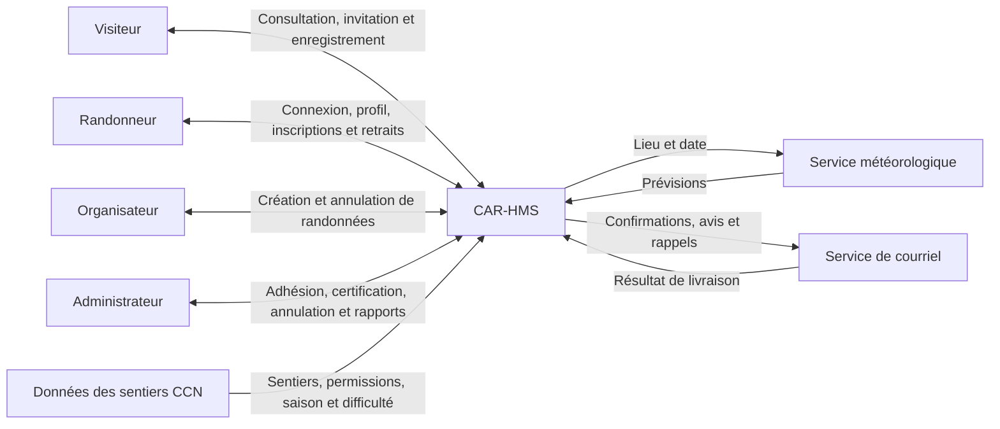

# Livrable 1

SEG 3502 - Architecture et Conception de logiciels

Groupe 13

Raphaelle Ghanem, 300355381

Xavier Lermusieaux, 300152646

CAR-HMS - Système de gestion des événements de randonnée du Club de randonnée Cairn

Date : 17 octobre 2026

Professeur : Kalonji Kalala

[Dépôt GitHub](https://github.com/seg3502-groupe13/groupe13-livrable1)

## 2. Sommaire exécutif

Ce document présente une analyse initiale du système de gestion des événements de randonnée du Club de randonnée Cairn (CAR-HMS), destinée au client et à l'équipe de développement.

Il décrit le contexte du système, les hypothèses formulées, le diagramme de contexte, les sous-domaines identifiés et les cas d'utilisation détaillés afin d'établir une base pour la conception et le développement du système.

## 3. Description de l'équipe et des rôles

| Membre | Tâches |
| --- | --- |
| Raphaelle Ghanem | Sections 1 à 6, structure du domaine et README des sous-domaines, revue des exigences. |
| Xavier Lermusieaux | Section 7, interfaces Kotlin, DTO de requête et contrats Cucumber. |
| Les deux membres | Références, validation des hypothèses, cohérence entre le rapport et le code, relecture. |

## 4. Hypothèses

1. Un visiteur peut créer son compte avec un code d'invitation et se connecter sans être déjà authentifié. Les autres fonctions, sauf la consultation des randonnées, demandent les autorisations appropriées.
2. Une randonnée complète reste visible et accepte des inscriptions en liste d'attente jusqu'à sa date limite.
3. Les niveaux débutant, intermédiaire, avancé et expert correspondent aux difficultés facile, modérée, difficile et très difficile. Un randonneur peut choisir une difficulté inférieure, égale ou supérieure d'un seul niveau à son habileté.
4. La date limite doit être future, précéder le début et se situer au maximum deux semaines avant celui-ci. À l'instant exact de la limite, les inscriptions et les retraits ne sont plus permis. Les dates sont interprétées selon l'heure d'Ottawa-Gatineau; une certification reste valide à sa date d'expiration.
5. La capacité compte les participants, sans l'organisateur. Un randonneur ne peut pas avoir deux inscriptions actives à la même randonnée.
6. Les changements automatiques du cycle de vie sont attribués au système. Ceux provoqués par une action sont attribués à l'utilisateur concerné. Une randonnée non annulée est considérée comme terminée à son début, sans suivi des présences.
7. Les dernières données CCN obtenues peuvent être conservées en lecture seule pour continuer pendant une panne. Si les informations nécessaires ne sont pas disponibles, la création concernée est refusée, mais les autres fonctions restent accessibles.
8. Pour ce livrable, le courriel et la date de naissance sont fixés à l'enregistrement. Le randonneur peut modifier son nom, ses coordonnées, son contact d'urgence et son habileté. L'administrateur gère l'adhésion et la certification.
9. Le rapport d'utilisation sélectionne les randonnées selon leur date de début, avec les deux bornes de période incluses. Le nombre de randonnées inclut les annulées. Le nombre de participants correspond aux inscriptions confirmées des randonnées non annulées, puisque les présences réelles ne sont pas suivies.
10. Le rappel est envoyé 24 heures avant le début. Une panne de courriel ne supprime pas une inscription ou une annulation déjà enregistrée; l'envoi peut être repris.

## 5. Diagramme de contexte du système

L'organisateur possède aussi les fonctions du randonneur. Les courriels sont destinés aux randonneurs concernés. Le processus d'adhésion au club, la distribution des invitations, la gestion des sentiers et l'organisation physique des sorties restent à l'extérieur du système.

## 6. Sous-domaines

| Sous-domaine | Classification | Justification |
| --- | --- | --- |
| hikes | Cœur | La création et le cycle de vie des randonnées constituent l'activité principale du système. Les règles de planification répondent aux besoins du club. |
| registrations | Cœur | Les inscriptions, l'admissibilité selon le niveau, la capacité et la liste d'attente permettent d'associer les membres aux randonnées adaptées. |
| trails | Support | Les informations CCN sont nécessaires pour choisir un sentier admissible. Le club ne crée pas et ne modifie pas ces informations. |
| hikers | Support | Les profils, les décharges, le statut d'adhésion et les certifications fournissent les informations nécessaires aux inscriptions et à l'organisation des sorties. |
| notifications | Support | Les confirmations, les avis et les rappels avec avertissement météo soutiennent la gestion des sorties selon les règles du club. |
| identity | Générique | L'authentification et le contrôle des rôles sont des fonctions standard qui peuvent utiliser des solutions existantes. |
| reporting | Support | Les statistiques d'utilisation des sentiers aident les administrateurs à suivre les activités du club. |

Chaque sous-domaine correspond à un sous-paquetage de `domain` portant le même nom, avec un README.

## 7. Analyse des cas d'utilisation

Les cas ci-dessous proviennent de CAR-Req-01, pages 7 et 8. Si les données ou les autorisations sont invalides, l'opération est refusée sans modifier les données.

### Parcourir les randonnées

Préconditions : aucune authentification nécessaire.

Étapes :

1. L'utilisateur consulte les randonnées ou recherche par nom de sentier, date ou difficulté.
2. Le système retourne les randonnées ouvertes ou complètes avant leur date limite, triées par date.
3. Il présente les informations de chaque randonnée, l'organisateur et les places restantes. Pour un randonneur connecté, il indique aussi les randonnées correspondant à son habileté.

Postconditions : les résultats sont affichés sans modifier les données. Une recherche sans correspondance retourne une liste vide.

### Enregistrer un randonneur

Préconditions : le visiteur est membre du club, possède un code d'invitation valide et n'a pas déjà un compte avec le même courriel.

Étapes :

1. Le visiteur fournit son code, son courriel, son mot de passe, son nom, son téléphone, son adresse, sa date de naissance, son contact d'urgence et son niveau d'habileté.
2. Il accepte la décharge de responsabilité. S'il a moins de 18 ans, le tuteur légal doit l'accepter et son nom est enregistré.
3. Le système valide les informations et crée le compte et le profil.

Postconditions : le randonneur est enregistré avec une adhésion active. Il peut se connecter et s'inscrire aux randonnées admissibles. Un code invalide, un courriel déjà utilisé ou une décharge manquante entraîne un refus.

### Se connecter

Préconditions : l'utilisateur possède un compte.

Étapes :

1. L'utilisateur fournit son courriel et son mot de passe.
2. Le système vérifie les informations.
3. Si elles sont valides, le système ouvre une session et donne accès aux fonctions autorisées selon le rôle.

Postconditions : l'utilisateur est connecté. Si les informations sont invalides, aucune session n'est ouverte.

### Se déconnecter

Préconditions : l'utilisateur est connecté.

Étapes :

1. L'utilisateur demande la déconnexion.
2. Le système ferme sa session.

Postconditions : l'utilisateur doit se reconnecter pour accéder aux fonctions protégées. Ses inscriptions sont conservées.

### S'inscrire à une randonnée

Préconditions : le randonneur est connecté, son adhésion est active, la randonnée est ouverte ou complète, la difficulté est admissible et la date limite n'est pas atteinte. Il n'a pas déjà une inscription active à cette randonnée.

Étapes :

1. Le randonneur sélectionne une randonnée et confirme son inscription.
2. Le système vérifie l'admissibilité et les places disponibles.
3. S'il reste une place, l'inscription est confirmée. La randonnée devient complète lorsque la dernière place est prise. Sinon, l'inscription est ajoutée à la fin de la liste d'attente.
4. Le système enregistre l'heure et le statut de l'inscription et envoie une confirmation ou la position dans la liste d'attente.

Postconditions : l'inscription est confirmée ou en attente, sans dépasser la capacité. Le changement de statut de la randonnée et l'utilisateur responsable sont enregistrés.

### Annuler une inscription

Préconditions : le randonneur est connecté et possède une inscription confirmée ou en attente à une randonnée non annulée. La date limite n'est pas atteinte.

Étapes :

1. Le randonneur sélectionne son inscription et confirme l'annulation.
2. Le système marque l'inscription annulée.
3. Si une place confirmée se libère, le premier randonneur en attente est confirmé automatiquement et reçoit un courriel.
4. Si une place reste libre, la randonnée redevient ouverte. Le système enregistre l'utilisateur responsable du changement.

Postconditions : l'inscription est annulée et la liste d'attente est mise à jour. Retirer une inscription en attente ne libère pas de place confirmée. Aucun retrait n'est accepté à partir de la limite.

### Mettre à jour un randonneur

Préconditions : le randonneur est connecté pour modifier ses informations, ou un administrateur est connecté pour modifier l'adhésion ou la certification d'un profil existant.

Étapes :

1. Le système présente les informations actuelles.
2. Le randonneur modifie son profil, ou l'administrateur change le statut d'adhésion ou fournit le numéro de certificat, les dates de délivrance et d'expiration et le niveau d'organisateur.
3. Le système vérifie les valeurs et les permissions, puis enregistre les changements.

Postconditions : les informations autorisées sont mises à jour. Une certification valide approuvée par un administrateur donne au randonneur le rôle d'organisateur et le niveau correspondant.

### Fermer une randonnée

Préconditions : la randonnée est ouverte ou complète et sa date limite est atteinte.

Étapes :

1. Le système détecte l'arrivée de la date limite.
2. Il change le statut de la randonnée à fermée.
3. Il enregistre l'instant du changement et le système comme responsable.

Postconditions : aucune nouvelle inscription ni annulation d'inscription n'est acceptée. Les inscriptions existantes sont conservées. L'organisateur ou un administrateur peut encore annuler la randonnée avant son début.

### Envoyer un rappel de randonnée

Préconditions : la randonnée n'est pas annulée et commence dans 24 heures.

Étapes :

1. Le système sélectionne les randonneurs ayant une inscription confirmée.
2. Il demande les prévisions pour le point de départ et la date de la randonnée.
3. Il prépare un courriel contenant la date, l'heure de début, le sentier et le point de départ.
4. Si de la pluie ou de la neige est prévue, il ajoute un avertissement. Si les prévisions sont indisponibles, le rappel est envoyé sans avertissement.

Postconditions : les participants confirmés reçoivent un rappel. Les personnes en attente ou annulées n'en reçoivent pas. Une panne de courriel permet une reprise de l'envoi.

### Créer une randonnée

Préconditions : l'organisateur est connecté et approuvé. Sa certification couvre la date de la randonnée et son niveau est au moins égal à la difficulté du sentier.

Étapes :

1. L'organisateur choisit un sentier CCN et fournit le titre, la description, la date et l'heure de début, la durée, la date limite et la capacité.
2. Le système vérifie que le sentier se trouve dans la région de la capitale nationale, que la randonnée y est permise et que la date respecte sa saison d'ouverture. La difficulté vient du sentier.
3. Il vérifie la certification, les informations obligatoires, la durée et la capacité positives et la date limite, au maximum deux semaines avant le début.
4. Si les données sont valides, il attribue un identifiant unique et enregistre la randonnée comme ouverte, avec le créateur et l'instant de création.

Postconditions : la randonnée peut être consultée et recevoir des inscriptions. Une donnée invalide ou un sentier non vérifiable empêche la création.

### Annuler une randonnée

Préconditions : l'organisateur de cette randonnée ou un administrateur est connecté. La randonnée n'est pas déjà annulée et n'a pas commencé.

Étapes :

1. L'utilisateur sélectionne la randonnée, indique un motif et confirme l'annulation.
2. Le système marque la randonnée annulée et enregistre le motif, l'instant et l'utilisateur responsable.
3. Il annule toutes les inscriptions confirmées et en attente.
4. Il avise les randonneurs concernés par courriel en indiquant le motif.

Postconditions : la randonnée et ses inscriptions actives sont annulées. L'annulation reste possible après la fermeture, mais pas à partir du début de la randonnée.

### Générer un rapport d'utilisation des sentiers

Préconditions : un administrateur est connecté.

Étapes :

1. L'administrateur choisit un sentier et une période dont la date de début ne dépasse pas la date de fin.
2. Le système sélectionne les randonnées du sentier dans cette période.
3. Il présente le nombre de randonnées, le nombre de participants et le nombre de randonnées annulées selon l'hypothèse 9.

Postconditions : le rapport est affiché sans modifier les données. S'il n'y a aucune randonnée, les trois nombres sont à zéro.

## 8. Références

- CAR-Req-01, Document des exigences initiales du CAR-HMS, automne 2026, pages 1 à 8.
- Livrable 1 : domaine initial, fichier SEG3102_Livrable1_FR1.pdf, pages 1 à 3.
- Notes de cours 1-Introductionfr.pdf, description des cas d'utilisation et diagramme de contexte, diapositives 19 et 27 à 28.
- Notes de cours 2-DomainFr.pdf, sous-domaines et classification, diapositives 26 à 29.
- Notes de cours 3-ArchitectureLogicielle.pdf, responsabilités et cohérence de la conception, diapositives 13, 24 à 26 et 77 à 84.

## Bonus : revue des exigences

1. Authentification avant l'enregistrement. Le document indique : « Tout accès aux fonctionnalités du CAR-HMS autre que la consultation des randonnées ouvertes doit exiger une authentification et une autorisation. » (CAR-Req-01, p. 3). Pourtant, un visiteur doit pouvoir créer son compte et se connecter. Nous autorisons ces deux actions sans session, ce qui permet au contrat `register_hiker.feature` de commencer avec un visiteur possédant une invitation valide.

2. Accès à la liste d'attente. Le randonneur « sélectionne une randonnée ouverte », mais « Si la randonnée est déjà complète, l'inscription est placée en liste d'attente selon l'ordre des inscriptions. » (p. 7). Nous gardons les randonnées complètes visibles avant la limite. Les contrats `browse_hikes.feature` et `sign_up_for_hike.feature` permettent donc de les consulter et de rejoindre leur liste d'attente.

3. Difficultés plus faibles. Le glossaire autorise une randonnée « à son niveau d'habileté ou à un niveau au-dessus » (p. 2), tandis que le cas détaillé dit « dont la difficulté est au plus d'un niveau supérieure à son niveau d'habileté » (p. 7). Nous retenons cette deuxième formulation, qui permet aussi les randonnées plus faciles. Les contrats de consultation et d'inscription utilisent la même correspondance des niveaux.

4. Responsable des changements automatiques. Le système doit enregistrer « l'utilisateur qui a effectué chaque étape du cycle de vie d'une randonnée » (p. 3), mais la fermeture arrive automatiquement à la date limite (p. 7). Nous utilisons le système comme responsable des transitions automatiques, et l'utilisateur pour celles provoquées par son action. Le contrat `close_hike.feature` vérifie ce responsable.

5. Indisponibilité de la CCN. Le club « ne tient pas lui-même d'informations sur les sentiers » (p. 2), mais « L'indisponibilité du ou des services externes ne doit pas empêcher le système de fonctionner correctement. » (p. 3). Nous conservons une copie en lecture seule des données CCN, sans permettre leur modification par le club. Le contrat `create_hike.feature` autorise son utilisation pendant une panne et refuse seulement la création si les renseignements nécessaires manquent.
